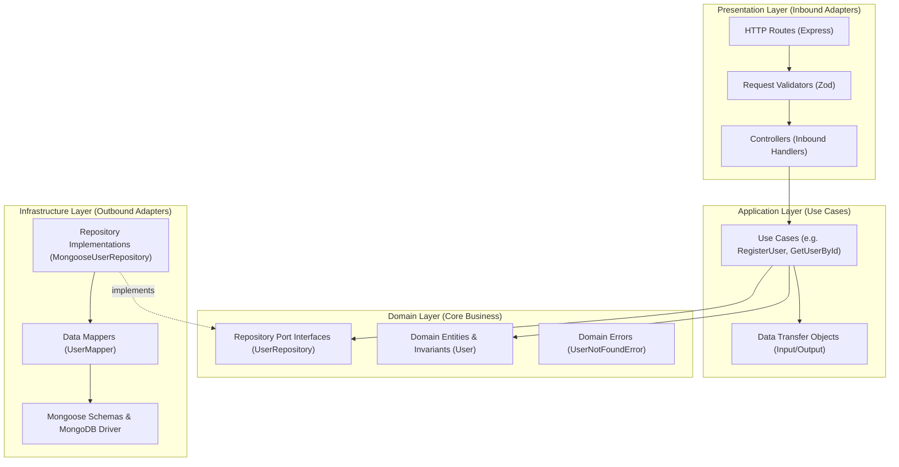

# Donkey Play Backend Architecture: Modular Monolith with Hexagonal Architecture

This document provides a comprehensive technical reference for the architecture of the **Donkey Play** backend API (`apps/api`).

---

## 1. Architectural Vision

Donkey Play is a real-time social discovery and random video chat platform. The backend is structured as a **Modular Monolith** employing **Hexagonal Architecture** (Ports and Adapters) and the **Repository Pattern**.

### Guiding Principles:
1. **High Cohesion, Low Coupling**: Each business domain owns its logic, data structures, and state transitions.
2. **Framework Independence**: Core business logic and domain entities have zero dependencies on Express, Mongoose, or database drivers.
3. **Pluggable & Mockable Infrastructure**: Use cases depend on repository interfaces (ports), allowing instant in-memory unit testing without database spinning.
4. **Monolithic Simplicity with Microservice Discipline**: Modular boundaries ensure future separation into standalone microservices if traffic demands, without upfront operational complexity.

---

## 2. Hexagonal Architecture Diagram



---

## 3. Directory Layout

```text
apps/api/
├── src/
│   ├── config/                       # Environment variables and DB connection
│   │   ├── env.ts
│   │   └── database.ts
│   ├── common/                       # Cross-cutting shared primitives
│   │   ├── errors/
│   │   │   └── AppError.ts
│   │   └── middleware/
│   │       ├── validateRequest.ts
│   │       └── errorHandler.ts
│   ├── modules/                      # Business modules
│   │   └── users/                    # Complete production-grade demonstration module
│   │       ├── domain/
│   │       │   ├── entities/User.ts
│   │       │   ├── repositories/UserRepository.ts
│   │       │   └── errors/UserErrors.ts
│   │       ├── application/
│   │       │   ├── use-cases/RegisterUserUseCase.ts
│   │       │   ├── use-cases/GetUserByIdUseCase.ts
│   │       │   └── dto/UserDTOs.ts
│   │       ├── infrastructure/
│   │       │   ├── persistence/mongoose/UserModel.ts
│   │       │   ├── persistence/repositories/MongooseUserRepository.ts
│   │       │   └── mappers/UserMapper.ts
│   │       ├── presentation/
│   │       │   └── http/
│   │       │       ├── controllers/UserController.ts
│   │       │       ├── routes/UserRoutes.ts
│   │       │       └── validators/UserValidators.ts
│   │       └── index.ts              # Module composition root & public exports
│   ├── app.ts                        # Express application assembly
│   └── server.ts                     # HTTP server startup & graceful shutdown
├── tests/
│   ├── health.test.ts
│   ├── mocks/
│   │   └── InMemoryUserRepository.ts
│   └── users/
│       ├── UserEntity.test.ts        # Pure domain unit tests
│       ├── RegisterUserUseCase.test.ts # Application use-case tests
│       └── UserRoutes.test.ts        # HTTP API integration tests
├── AGENTS.md                         # Rules and constraints for AI agents
├── package.json
└── tsconfig.json
```

---

## 4. Module Implementation Status & Roadmap

| Module | Status | Description |
| :--- | :--- | :--- |
| `users` | **Implemented** | User registration, profile fetching, karma scoring, and domain invariants |
| `auth` | *Planned* | Session management, OAuth / passwordless auth, JWT tokens |
| `matching` | *Planned* | Queue management, random peer pairing algorithm, preference filters |
| `chat` | *Planned* | Real-time text messaging, socket delivery, ephemeral history |
| `video-call` | *Planned* | WebRTC signaling, ICE candidate exchange, session moderation |
| `wallet` | *Planned* | Coins, credits, transaction ledgers, in-app purchases |
| `gifts` | *Planned* | Virtual gifting during video calls and chat |
| `moderation` | *Planned* | User reporting, automated screenshot moderation, strikes and bans |

---

## 5. Persistence Strategy with MongoDB & Mongoose

1. **Decoupled Data Layer**:
   Mongoose models and schemas exist strictly within `infrastructure/persistence/mongoose/`.
2. **Bi-directional Mapping**:
   `UserMapper.toDomain(doc)` turns database records into pure `User` domain entities.
   `UserMapper.toPersistence(user)` extracts persistence attributes for MongoDB `$set` updates.
3. **Optimized Queries**:
   Unique indices on `userId`, `email`, and `username` ensure high performance and data integrity at the database level.

---

## 6. How to Implement a New Module (Step-by-Step)

When implementing a new module (e.g., `wallet`):

1. **Define the Domain**:
   - Create `domain/entities/Wallet.ts` with encapsulated invariants.
   - Define `domain/repositories/WalletRepository.ts` port interface.
   - Define custom `domain/errors/WalletErrors.ts` extending `AppError`.
2. **Define Application Use Cases**:
   - Create DTOs in `application/dto/WalletDTOs.ts`.
   - Write single-responsibility use cases in `application/use-cases/`.
3. **Build Infrastructure Adapters**:
   - Define Mongoose schema in `infrastructure/persistence/mongoose/WalletModel.ts`.
   - Implement `infrastructure/mappers/WalletMapper.ts`.
   - Implement `infrastructure/persistence/repositories/MongooseWalletRepository.ts`.
4. **Build Presentation Layer**:
   - Write request schemas in `presentation/http/validators/`.
   - Write `presentation/http/controllers/WalletController.ts`.
   - Mount routes in `presentation/http/routes/WalletRoutes.ts`.
5. **Create Composition Root (`index.ts`)**:
   - Export `createWalletModule()` returning `{ router, useCases, repository }`.
   - Export necessary public types and contracts.
6. **Mount in `src/app.ts`**:
   - Wire `app.use('/api/v1/wallets', walletModule.router)`.
7. **Write Tests**:
   - Domain tests (`tests/wallet/WalletEntity.test.ts`).
   - Use case tests with an in-memory mock repository.
   - Supertest API integration tests.

---

## 7. Quality & Verification Commands

```bash
# Run linting
pnpm --filter api lint

# Run TypeScript typechecking
pnpm --filter api typecheck

# Run tests
pnpm --filter api test

# Build production bundle
pnpm --filter api build
```
